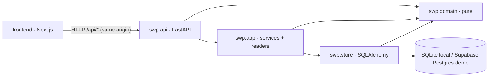
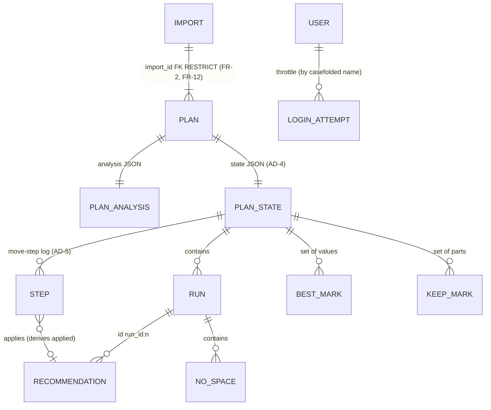
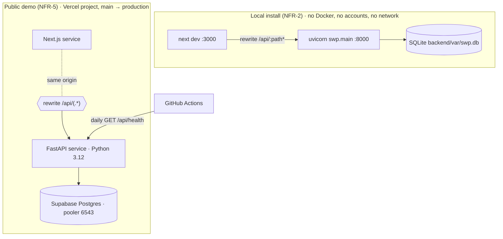

# Architecture Spine: Smart Warehouse Planner

PRD terms (§3 Glossary) and IDs (FR-n, NFR-n, UJ-n) are used verbatim. No `[ASSUMPTION]` remains: the last two (the root `npm run dev` with concurrently, and preview deployments off for the whole project) were confirmed on 2026-11-16.

## Design Paradigm

**Functional core, imperative shell.** All warehouse logic lives in `swp/domain` as pure Python: import checks, classification, pick groups, rules, rounds, the planning copy, outdated status, before/after, move-list order and the wall layout. Everything that does I/O is a thin shell around it. The backend is authoritative for plan state. The frontend renders server views and sends commands.

| Layer | Directory | May import |
| --- | --- | --- |
| domain (pure) | `backend/swp/domain/` | stdlib, pydantic |
| store (persistence) | `backend/swp/store/` | domain, SQLAlchemy |
| app (services, transactions, file readers) | `backend/swp/app/` | domain, store, openpyxl, defusedxml |
| api (HTTP) | `backend/swp/api/` | app, domain (commands and views as wire models) |
| frontend (UI) | `frontend/` | generated API types; HTTP `/api/*` only |



`import-linter` contracts in CI enforce this table. Only `swp.store` may import SQLAlchemy, and `swp.domain` imports nothing from `swp` outside itself.

## Invariants & Rules

### AD-1: Pure domain [ADOPTED]

- **Binds:** NFR-1, NFR-3, FR-16–FR-29, FR-34, FR-37, FR-38, SM-1
- **Prevents:** rule logic in routers, SQL or React; nondeterminism; two implementations of one fact.
- **Rule:**
  - `swp/domain` imports only the stdlib and pydantic. It does no database, file, network, clock or randomness work, and `uuid4`, `datetime.now` and `random` are banned there through ruff `banned-api`.
  - Time and the user come in as `CommandContext(now, user)`, and settings come from the plan's `analysis` (AD-4). New IDs are derived as `uuid5(command_id, "<kind>:<n>")`, so a retry reproduces the same state.
  - The shared facts have one implementation, in `domain/planning.py`: `current_location`, `is_empty`/occupied, `stock_at`, `aisle_of`, `covering_marks` and `run_baseline` (AD-5). Every other module imports them and never re-derives them.
  - The answer-key tests (`backend/tests/domain/`) call the domain directly with `data/answer-key/`.

### AD-2: Two deployables, one origin [ADOPTED]

- **Binds:** all; NFR-2, NFR-5
- **Prevents:** the browser talking to two hosts, logic or DB access split across frontend and backend, and `/api` path mismatches between environments.
- **Rule:**
  - The backend (FastAPI) owns all logic and persistence. The frontend (Next.js) has neither.
  - The browser calls relative `/api/*` paths only. Every FastAPI router is mounted under `/api`, and both rewrites keep the full path: locally, Next.js sends `/api/:path*` to `http://127.0.0.1:8000/api/:path*`; on Vercel, the Services rewrite sends `/api/(.*)` to the backend service (entrypoint `swp.main:app`).
  - The frontend fetches client-side with TanStack Query. No server component, route handler or server action calls the backend.
  - `GET /api/health` runs `SELECT 1`.
  - Fallback, if Vercel Services (Beta) fails: two Vercel projects, with a Next.js rewrite to the backend URL. The contract stays the same.

### AD-3: Server-authoritative plan state and consistent views

- **Binds:** FR-9, FR-10, FR-13–FR-15, FR-20, FR-22–FR-38, FR-42, FR-51
- **Prevents:** the browser and the backend disagreeing about the planning copy; views mixed from two plan versions; the client re-deriving plan logic for previews, counts or search.
- **Rule:**
  - The frontend never computes rules, the planning copy, occupancy, outdated status, before/after counts, move-list order, wall layout, search results or the effect of a move. Plan state is never shown before the server confirms it.
  - **Views.** Every plan view response carries the plan `version` it was computed from. After each confirmed command the client refetches every `['plan', planId]` query. It renders a set of plan queries together only when their versions agree; otherwise it refetches the stale ones (at most 2 times).
  - **Import-scoped data** (the wall layout from AD-15 and the static location columns) is served under `['import', importId]` with an immutable cache, and the refetch after a command leaves it alone.
  - **Plan summary.** `GET /api/plans/{id}` is the plan summary: the plate data, each step's check state and counts, `apply_all_count`, `undo_preview` (AD-5) and the current round. The toolbar, flow bar and launcher read only this view.
  - **Previews and search.** `GET /api/plans/{id}/moves/preview?part=&from=&to=` returns `{allowed, refusal_message?, effect: new | adds_to_stock | combines_with(n) | removes_move(n), target: empty | occupied | none, target_parts[]}` from `domain.planning` and writes nothing. `target_parts` lists the parts stored at `to` (number, description, class, picks, stock, kept in place), so the drop dialog never computes them. The Manual move dialog and the drop targets use it, and the command checks again on submit. Search is `GET /api/plans/{id}/search?q=`: partial match, Python `casefold`, results in AD-14 order.
  - The backend has no cross-request cache of plan state. A request runs `replay` once and builds everything it returns from that one fold.

### AD-4: Plan aggregate as versioned documents

- **Binds:** FR-2, FR-6, FR-7, FR-9, FR-11, FR-12, FR-18, FR-36, NFR-12
- **Prevents:** plan state spread over tables that drift; two owners of one entity; old plans failing to open after a milestone; FR-2 copying a stale analysis; races between delete and reuse.
- **Rule:**
  - **Plan row.** It holds `id`, `name`, `import_id` (an FK with `ON DELETE RESTRICT`), `created_by/at`, `last_edited_by/at` (NOT NULL; set equal to `created_*` at creation) and `version`, plus two JSON documents:
    - `analysis`: the settings snapshot, `period_start` and `period_end`, the movement classes and the pick groups;
    - `state`, validated by `domain.state.PlanState`: the best-location marks (a set of values: `{kind:"aisle",aisle}`, `{kind:"level",level,aisle|null}` or `{kind:"location",location}`), the keep-in-place marks (a set of part numbers), the runs (id, round, created at/by, recommendations, "no space" entries), the step log (AD-5), `next_move_number`, and `recent_commands` (the last 50 `(command_id, result)` pairs).
  - **Derived fields.** `current_round` is derived (the highest run round, or 0) and never stored. `PlanState.new()` is the only constructor.
  - **Import row.** It holds `uploaded_at` (a UTC instant), `data_as_of` (the newest date over **every** data row of the Transactions file, all types included) and `data`: the normalized form, with these parts:
    - `locations` keyed by code;
    - `inventory` merged by `(part, location)` per FR-6, with zero-stock rows kept;
    - `parts` as `{part: the first non-blank description in file order}`;
    - `transactions` reduced to the fields the analysis needs.

    The import is frozen after insert (FR-36). Plan views never load `transactions`. Uploaded file bytes are never stored.
  - **Creation.** `app.plans.create(import, settings)` is the only creation path for both New Plan from files (FR-1) and New Plan from an existing import (FR-2). It always computes `analysis` from the stored import with the current `analysis.toml`, and never copies another plan's `analysis` or `state`. After creation, everything derived from settings (thresholds in reasons, the period, class limits) reads `plan.analysis`.
  - **Schema evolution.** `state`, `analysis` and `data` each carry `schema_version`. `domain/state_migrations.py` holds one append-only chain of pure upcasters per document. A change to a stored shape adds the next upcaster and a fixture `tests/domain/fixtures/<doc>_v<n>.json` in the same change. The store upcasts on read. A GET never saves (FR-9); the next command writes the current version. Alembic never rewrites JSON contents. Milestone 1 already declares every field above, with defaults.
  - **Deleting.** Delete and the FR-2 create lock the import row. The import is deleted in the same transaction as the last plan that uses it (FR-12).

### AD-5: Moves are an append-only step log, and the planning copy is a fold

- **Binds:** FR-29, FR-31, FR-33, FR-34, FR-35, FR-37, FR-38, FR-51, Move number
- **Prevents:** a stored planning copy that disagrees with the moves; undo that names one move and reverts another; a run-time state that two stories rebuild differently.
- **Rule:**
  - **Steps.** A step is one move as it was made: its move number (from `next_move_number`, never reused), part, from-location, to-location, rule, round, recommendation id (or none) and `swap_id` (or none).
  - **Replay.** The planning copy, the effective moves (FR-34 combination and removal) and the current locations always come from `domain.planning.replay(import, steps)`, which implements FR-34 from its first story. None of them are stored. A combined move shows the number of its first step.
  - **Round invariant.** Every step made after run *k* and before the next run or reset has round *k*, and no step with round *k* comes before run *k*. `domain.apply` asserts this.
  - **Run baseline.** `run_baseline(import, steps, k) = replay(import, steps with round < k)` is the planning copy when run *k* was made. It is valid while run *k* has an open recommendation, because any undo outdates them all (AD-7). FR-31's "empty when the run was made" means empty in `run_baseline`.
  - **Undo and reset.** Undo deletes the last step. Its command carries `expected_move_number`; if the last step has a different number, the command is rejected with `command_rejected`. The plan summary's `undo_preview` is built from the last step: `{move_number, part, from, to, effect: reverts_move(n) | splits_combined_move(n) | restores_removed_move(n)}`. Every Undo surface renders it and nothing else. Reset deletes all steps and runs, sets `next_move_number` to 1 and keeps the marks. Marks and runs are not steps, so undo never reverses them.

### AD-6: Every change is one idempotent, serialized command

- **Binds:** FR-10, FR-21, FR-23, FR-30–FR-35, FR-51, NFR-8
- **Prevents:** parallel save paths; lost updates and reused move numbers under concurrency; a retry applied twice; the UI reconstructing what a command did.
- **Rule:**
  - **Endpoint and command list.** Plan changes go only through `POST /api/plans/{id}/commands`, with body `{command_id, base_version, type, …}`. The complete list of types (closed: a new one is added here first):
    - marks: `set_best_mark`, `remove_best_mark`, `set_keep`, `remove_keep`;
    - runs and recommendations: `run`, `apply`, `apply_all`, `apply_other_location`;
    - moves: `manual_move`, `move_parts`, `put_together`, `swap`;
    - history: `undo`, `reset`.

    Commands refer to marks by value and to recommendations by `id`, never by index, number or part.
  - **Result.** The response is `{version, events[]}`. `events` is a closed union built by the domain: `move_made`, `moves_combined`, `move_removed`, `swap_made`, `step_undone`, `recommendations_outdated{count, cause}`, `run_done{round, recommendations, no_space}`, `plan_reset{moves_removed}`, `mark_set`, `mark_removed`, `keep_set`, `keep_removed`, `apply_all_done{applied[], skipped[{number, cause}]}`. A repeated `command_id` returns the stored result. A no-op (setting a mark that already exists, removing one that doesn't) returns 200 with no events and does not bump `version` or `last_edited_*`.
  - **Service.** `swp.app` reads the plan, runs `domain.apply(state, command, ctx)` and then `domain.recommendations.revalidate`, and saves with `UPDATE … SET state=…, version=version+1 … WHERE id=:id AND version=:read_version`. When 0 rows change, it re-reads and re-applies, up to 3 times. SQLite transactions start with `BEGIN IMMEDIATE`; Postgres may also use `SELECT … FOR UPDATE`. `base_version` is recorded but not enforced, so the command applies on top of the current state. FR-41 later adds a warning.
  - **Apply all.** It folds over the latest run's recommendations in `number` order. Each one is applied if it is open, its part is not kept in place, and it passes `revalidate` on the intermediate state, with `revalidate` run again after each apply. The whole fold is one transaction and one version bump.
  - **Other writes.** The only other writes are New Plan (`POST /api/plans`, multipart, not idempotent: the client disables submit while it is in flight and never retries it) and Delete (`DELETE /api/plans/{id}`). GET requests never write (FR-9).

### AD-7: Recommendation identity, status and outdated rules

- **Binds:** FR-23, FR-28–FR-32, FR-34, FR-35, FR-42
- **Prevents:** "applied" having two owners; numbers that differ between the list and the wall; a stale apply hitting a new round's recommendation; two readings of "the rule no longer holds".
- **Rule:**
  - **Identity.** A recommendation has `id = "<run_id>:<n>"` and `number = n`, assigned at run time in AD-14 order (rule 1, then 2, then 3, each in its processing order) and never renumbered. "No space" entries are keyed by `(run_id, part)` and have no number. Every view shows the server's `number`. A command naming a recommendation outside the latest run is rejected with `command_rejected`.
  - **Status.** Only `open` and `outdated(cause)` are stored. `applied` is derived from the step log: a recommendation is applied when a step references it, and its view shows that step's effective move. If FR-34 has removed that move (the part was moved back), the view shows it as outdated with the derived cause `moved_back`. Undoing the move-back brings it back. "Kept in place" is derived from the keep marks when the view is built and is never a status.
  - **Revalidate.** An open recommendation *r* of run *k* becomes outdated, sticky until the next run, by the **first** of these that is true:
    1. `moved`: a step of *r*'s part with round *k* exists that doesn't reference *r*.
    2. `filled`: the suggested location is not empty. The cause records the location and the move number that filled it.
    3. `marks`: a mark condition of the rule fails. Rule 1: the suggested location is best and the from-location is not. Rule 2: the from-location is best and the suggested location is not. Rule 3: the from-location is not best, and for a slow-moving or dead-stock part the suggested location is not best.
    4. `partner_aisle` (rule 3): the partner's current aisle is not the suggested location's aisle.

    Nothing else outdates a recommendation. Undo sets `outdated(undo)` on every open recommendation and on the recommendation the undone step referenced.
  - **Runs.** A run deletes every earlier recommendation and "no space" entry that no step references, and keeps the earlier runs' metadata. Only the latest run's recommendations appear in the recommendation tabs. Open recommendations whose part is kept in place show under Kept in place, not under Open or No space, and cannot be applied.
  - `domain.recommendations.other_locations(state, rec_id)` is the only implementation of FR-31's allowed set. The "Other location" list and `apply_other_location` both use it.

### AD-8: Import is read in the shell, validated in the domain, saved whole

- **Binds:** FR-1, FR-3–FR-7, FR-36, NFR-8
- **Prevents:** a half-saved import; two parsers reading the same cell differently; hostile files on the public demo.
- **Rule:**
  - **Readers (shell).** `swp/app/imports/readers.py` turns bytes into a `RawSheet` (a header plus rows of typed cells: `str | int | Decimal | datetime | date | None`).
    - `.xlsx`: openpyxl with `defusedxml`, read-only and values-only, first worksheet only. A file over 50 MB uncompressed is rejected before it is opened. Reading stops at row `MAX_ROWS_PER_FILE + 1`, after 100 columns and at 1,000 characters per cell. A float becomes `Decimal(repr(f))`.
    - `.csv`: UTF-8 with any BOM stripped (anything else is rejected). The delimiter is whichever of `,` and `;` appears more often in the header row.
    - Any other extension is rejected with the file name.
  - **Validation (domain).** `domain.import_` turns three `RawSheet`s into either a normalized import (AD-4) or every error, per file:
    - **Header and rows.** The header is the first non-blank row. Names are trimmed and case-insensitive, and a duplicated required column is rejected. Fully blank rows are skipped. Error rows are spreadsheet rows, with the header as row 1.
    - **Text.** Text is trimmed, including non-breaking spaces, and keeps its case. Transaction Type matches the four known names ignoring case.
    - **Identifiers** (Part, Location, Aisle, Level, Section, Position, Transaction Code, Warehouse). An integer or integral numeric cell becomes integer text without `.0`; leading zeros already lost in a numeric `.xlsx` cell can't be recovered. A non-integral number is rejected.
    - **Numbers** (Quantity, Walk Path). A numeric cell, or text of the form optional `-`, digits, optional decimal part with `.` or `,`. Thousands separators are rejected. Quantity must be `≥ 0`.
    - **Dates.** A date cell, or text `YYYY-MM-DD` or `DD.MM.YYYY`, optionally followed by a time. The time and any offset are discarded without conversion. Other formats are rejected as ambiguous.
    - **Empty and mixed files.** A file with no data rows is rejected. More than one distinct Warehouse value, within a file or across the three files, is rejected.
  - **Errors.** The `import_invalid` details are `[{file_role: locations | inventory | transactions, file_name, status: passed | failed | not_checked, errors: [{row, column, message}] (at most 20), more_count}]`.
  - **Saving.** Nothing is saved unless all three files pass. Then one transaction stores the import, the plan and its analysis.
  - **Import UI.** The screen shows upload progress, then one server step ("Checking files and computing classes and pick groups…"). Cancel is offered only while uploading.

### AD-9: One storage layer, portable schema [ADOPTED]

- **Binds:** NFR-2, NFR-4, NFR-5, NFR-6, NFR-12
- **Prevents:** code that works on SQLite and fails on Postgres; database access outside `swp/store`; migrations and seeding run from two places.
- **Rule:**
  - **Engine.** SQLAlchemy 2.1, sync ORM, with Alembic (`render_as_batch=True`). Only `swp/store` imports SQLAlchemy.
  - **Types.** Portable only: `Uuid` primary keys, `JSON` columns, and a `UtcDateTime` TypeDecorator that returns aware UTC times on both engines. JSON is written only as `Model.model_dump(mode="json")`, replacing the whole value. Decimals use `domain.values.Dec`, serialized as a normalized plain string (`"5"`, `"2.5"`).
  - **Databases.**
    - Local: `DATABASE_URL` defaults to `<backend>/var/swp.db`, resolved from `config.py`'s location, with `var/` created if missing.
    - Demo: Supabase Postgres through the transaction pooler (port 6543, `NullPool`, psycopg `prepare_threshold=None`). A `postgresql://` URL is rewritten to `postgresql+psycopg://`.
    - Migrations use `MIGRATION_DATABASE_URL` (the session pooler, 5432) when it is set.
  - **Migrate and seed.** `swp.app.bootstrap(upgrade, seed)` is the only path that does either. The CLI `swp db upgrade` calls it. The FastAPI lifespan calls it only when `APP_ENV=local`. Migrations are expand-only.
  - **Tests.** Persistence tests run on SQLite. CI also runs `tests/app` against Postgres 17.

### AD-10: Identity, sessions and feature flags [ADOPTED]

- **Binds:** FR-11, FR-39, FR-40, FR-50, NFR-5, NFR-6
- **Prevents:** milestone 1 and milestone 2 recording users differently; flag drift between the frontend build and the backend; a demo shortcut leaking into a local install; an expired session losing an edit.
- **Rule:**
  - **Flags.** `FEATURE_AUTH` and `FEATURE_DEMO` are backend env vars. The frontend reads them at runtime from `GET /api/session` (`{user | null, feature_auth, feature_demo, max_upload_bytes}`), so there are no `NEXT_PUBLIC_FEATURE_*` vars.
  - **Auth off (milestone 1).** Every request acts as the user `planner`.
  - **Auth on.**
    - Usernames: letters and digits (`str.isalnum`), 1–32 characters, unique by `casefold`, stored as registered. `planner` and `demo` are reserved.
    - Passwords: 4–64 characters and at most 72 UTF-8 bytes, hashed with bcrypt.
    - Session: an HS256 JWT (PyJWT) with `sub` = the user's UUID, in the httpOnly `SameSite=Lax` cookie `swp_session` (`Secure` in production), valid for 30 days. The user is loaded on every request. Logout is `POST /api/auth/logout`.
    - Startup: the backend refuses to start in production with an empty or default `JWT_SECRET`, or when `VERCEL` is set and `APP_ENV` is not.
  - **Page guard.** The client layout calls `/api/session`. Without a user, it sends the visitor to Log in, or to the demo front page when `feature_demo` is on.
  - **Created and edited by.** `created_by` and `last_edited_by` are the username as text, with no FK.
  - **Demo on (public deployment only).** The demo front page and `POST /api/auth/demo` (no password, no throttle, 404 when the flag is off) log the visitor in as `demo`. The seed is idempotent (an integrity error counts as success), does not count toward `MAX_ACCOUNTS`, and takes the password from `DEMO_PASSWORD` (default `demo`).

### AD-11: Error contract and copy ownership

- **Binds:** FR-3–FR-5, FR-12, FR-28, FR-29, FR-39, FR-40, all API
- **Prevents:** each screen inventing its own error parsing and wording; reasons and causes worded differently in the list, the wall and tooltips.
- **Rule:** every API error is `{"error": {"code", "message", "details": []}}` with this closed list of codes in `swp/api/errors.py`:

  | Code | HTTP status | Notes |
  | --- | --- | --- |
  | `import_invalid` | 422 | details: AD-8 |
  | `validation_failed` | 422 | details: `[{field, message}]`; also replaces FastAPI's request-validation errors |
  | `command_rejected` | 409 | |
  | `plan_not_found` | 404 | |
  | `not_found` | 404 | |
  | `unauthenticated` | 401 | |
  | `forbidden_origin` | 403 | |
  | `login_locked` | 429 | |
  | `limit_reached` | 413 | for upload size and rows |
  | `limit_reached` | 409 | for plans and accounts |
  | `internal` | 500 | |
  | `unavailable` | 503 | the database is busy; the client retries (AD-12) |

  - **Messages.** The backend writes `message` as final English copy for errors, and never puts a date or time in it.
  - **Other copy.** Recommendation reasons, outdated causes and command events are structured data. They are worded in one frontend module, `frontend/lib/copy`, from the EXPERIENCE.md wording.
  - **Client parsing.** The frontend branches only on `code`. A response without the envelope, such as Vercel's own 413, is treated as `internal`, with the HTTP status in `details`.

### AD-12: Client command flow

- **Binds:** FR-10, FR-12, FR-40, EXPERIENCE.md save and error states
- **Prevents:** commands built on a screen the server no longer matches; endless retries; lost edits on session expiry.
- **Rule:** `frontend/lib/commands` sends one command at a time per plan.
  - **While unconfirmed.** Every plan-changing control is `aria-disabled` with the reason "Saving the last change…". Transient UI that is not plan state may show until the response arrives: the dragged bin, "Running…".
  - **Network error or 502/503/504.** Retry with the same `command_id` after 1, 2, 4 and 8 s, showing "The last change was not saved yet. Trying again." After that, or after a 500: drop the command, refetch, and show "The change was not saved. Try again." For `run`, show the "Run failed" state from EXPERIENCE.md instead.
  - **`unauthenticated`.** Keep the command, go to Log in, and resend it after login.
  - **`plan_not_found`** (from any request). Show "This plan was deleted." and open the saved-plans list (milestone 1: New Plan).
  - **Other 4xx.** Drop the command, show `message`, refetch.
  - One TanStack Query error hook applies the same 401/404 rules to GETs.

### AD-13: Generated API types, snake_case on the wire

- **Binds:** all API consumers
- **Prevents:** two command unions; hand-written TypeScript types drifting from the backend.
- **Rule:**
  - **Wire models.** The command union (`swp/domain/commands.py`) and the plan views (`swp/domain/views/`) are the wire models; FastAPI uses them directly. `swp/api/schemas` holds only API-own shapes: session, auth, saved-plans rows and errors.
  - **TypeScript types.** `openapi-typescript` generates `frontend/lib/api/schema.ts` from `swp openapi`. CI regenerates the file and fails on any diff. JSON keys are snake_case, with no case transform.
  - **zod** validates form input only. It never mirrors API shapes.
  - **Tests.** Answer-key test helpers map "apply 1100" to the recommendation `id`. There is no part-based command.

### AD-14: Ordering is owned by the domain

- **Binds:** FR-13, FR-14, FR-20, FR-24–FR-27, FR-38, FR-42, Text order
- **Prevents:** a list re-sorted differently from the rules; `localeCompare` and lexical number sorts.
- **Rule:**
  - **Rule-defined order.** Every rule-defined order (recommendations, "no space", pick groups, the move list, aisles, levels, wall cells, search results) comes from `domain/ordering.py`. Text order is Python `str` comparison by code point. Identifier columns whose values are all digits within an import (Level, Section, Position) sort numerically. The frontend shows these lists in server order.
  - **User-picked table sorts** (FR-13). Text compares with `<`/`>`, never `localeCompare`. Integers compare as numbers. Decimal columns compare by a server-supplied `sort_rank`. Ties keep server order.

### AD-15: Wall layout is a domain view

- **Binds:** FR-14, FR-42, FR-51, EXPERIENCE.md Warehouse wall
- **Prevents:** the frontend parsing location codes; the wall disagreeing with the Locations data.
- **Rule:**
  - **Layout.** `domain/layout.py` builds each aisle's logical cells (run, row, column, gap), including the two-run section split and the end cap's Walk Path. It takes the layout from the Section and Position columns when the Locations file has them; else from the code pattern `<aisle>-<section>-<level>-<position>`; else as one run per level in Walk Path order. Virtual locations are never on the wall.
  - **Location references.** Every view refers to a location as `LocationRef {code, aisle, level, section?, position?, is_best}`.
  - **Frontend.** Pixel sizes, crops (a window of N sections, or N positions in the fallback layout) and route lines between logical cells are the frontend's. Deriving cells is not.

### AD-16: Drag and swap expand to steps on the server

- **Binds:** FR-33, FR-34, FR-35, FR-38, FR-51
- **Prevents:** a swap saved as half its moves; a different step order per caller.
- **Rule:**
  - A drop sends one command: `move_parts`, `put_together` or `swap`.
  - The backend expands it into Manual steps in the current round: first each chosen part from → to, then each back-part to → from. The steps of a swap share one `swap_id`.
  - Everything is one transaction with one version bump. Undo removes one step at a time.
  - A part chosen on both sides of a swap is rejected with `command_rejected`.

### AD-17: Move list is a domain view

- **Binds:** FR-38, UJ-2, UJ-3, SM-6, NFR-9
- **Prevents:** print order or swap marks computed in two places; a stale printout.
- **Rule:** `domain/move_list.py` builds the lines, their order and the swap marks.
  - **Rounds.** The header's "rounds" counts the distinct rounds that have a move. Round numbers are printed as stored, gaps kept, and round 0 is labelled as before the first run.
  - **Swap marks.** A swap group is marked only when it is intact: every step with that `swap_id` exists and is its own effective move. A cycle made with manual moves prints as ordinary Manual lines in Walk Path cycle order.
  - **Print route.** The print route refetches its view on mount and before printing, renders only after the response arrives, and never reorders. The header and column heads sit in a repeating `<thead>`. "Page X of Y" is best effort. Black and white, A4 portrait.
  - **Generated at.** `generated_at` is the server instant of the request, formatted by the frontend in the viewer's zone.

### AD-18: Limits on uploads, accounts and the public demo

- **Binds:** FR-1, FR-12, FR-39, FR-50, NFR-5, NFR-7, NFR-8
- **Prevents:** Vercel's 4.5 MB request and response limits failing without explanation; the open demo filling up; one person locking out the demo account.
- **Rule:**
  - **Limits** (env, enforced in `swp.app`):

    | Limit | Default | Applies |
    | --- | --- | --- |
    | `MAX_UPLOAD_BYTES` (one New Plan request) | 4,000,000 | always; the frontend checks the total before uploading |
    | `MAX_ROWS_PER_FILE` | 25,000 | always; a test on a generated max-size import keeps every view under 4 MB |
    | `MAX_PLANS` | 50 | only when `FEATURE_DEMO` is on |
    | `MAX_ACCOUNTS` | 200 | only when `FEATURE_DEMO` is on |

  - **Login throttle.** Failed logins are counted per casefolded submitted username, whether or not the account exists. After 5 failures, logins for that name are blocked for 60 s with `login_locked`. `POST /api/auth/demo` bypasses the throttle.
  - **Accepted risks on the demo.** Any visitor can delete any plan, and drive-by sign-ups can fill `MAX_ACCOUNTS`; Demo version still works.

### AD-19: Same-origin request guard

- **Binds:** NFR-5, NFR-6, FR-40
- **Prevents:** cross-site requests changing plans, which a cookie alone doesn't stop, and with auth off there is no cookie at all.
- **Rule:**
  - No CORS middleware in any environment.
  - `swp/api` middleware rejects `POST`/`PUT`/`PATCH`/`DELETE` with `forbidden_origin` unless `Sec-Fetch-Site` is `same-origin`, or, when that header is absent, `Origin` matches the request host.
  - Request bodies are `application/json`. Only `POST /api/plans` is multipart.
  - No GET writes. A test (`test_nfr6_cross_site_post_rejected`) proves the guard.

### AD-20: URLs carry what is shown

- **Binds:** FR-8, FR-9, FR-15, FR-42, EXPERIENCE.md navigation and selection
- **Prevents:** each module inventing its own hand-off for "open this location, move or part"; the Back button behaving differently per step.
- **Rule:**
  - **URL.** The URL is the source of what is shown and selected: `/plans/{id}/{step}?aisle=&loc=&rec=&move=&part=`. One helper in `frontend/lib/view-state` builds every such link.
  - **localStorage** keeps only the last values per plan (`swp:plan:<id>:view`), used to fill a bare URL, and the Key colours (`swp:colours`). It is read and written inside try/catch. The colours fall back to memory for the page's life and are applied before first paint by an inline script. It is never sent to the server.
  - **Milestone 1 start.** In milestone 1, `/` redirects to the most recently edited plan, or to `/plans/new`, using the same list endpoint as FR-8.

## Consistency Conventions

| Concern | Convention |
| --- | --- |
| Naming | Glossary terms verbatim: Python snake_case, TS camelCase for local identifiers, PascalCase for types and components. Values: movement class `fast`/`medium`/`slow`/`dead`; rule `rule_1`/`rule_2`/`rule_3`/`manual`; outdated cause `moved`/`filled`/`marks`/`partner_aisle`/`undo` (stored) and `moved_back` (derived). Python package `swp`. API paths are plural nouns under `/api`. Modules avoid the keyword `import` (`import_`). |
| IDs and values | Plan, import, run and user IDs are UUIDs. Recommendation IDs are `<run_id>:<n>`. Part numbers and location codes are text, exactly as normalized at import. Quantities and Walk Path are `Dec`, sent as normalized decimal strings. |
| Dates and times | Every instant is stored in UTC and sent as ISO 8601 with `Z`. Only the frontend formats instants, in the viewer's zone; the upload date shown is the local date of `uploaded_at`. `data_as_of`, `period_start` and `period_end` are plain `YYYY-MM-DD` dates. |
| Errors | AD-11 shape. Domain functions raise `DomainError(code, message, details)`, which only `swp/api` turns into HTTP. |
| Config | Settings in `swp/config.py` (pydantic-settings). The backend starts with zero env vars locally. Analysis settings are in `backend/settings/analysis.toml`, read only by `app.plans.create`. Secrets are never committed, and `.env.example` files hold no real values (NFR-6). |
| Logging | The stdlib `logging` to stdout: one line per request (method, path, status, ms), and the full traceback for `internal`. No external log service. |
| Fonts and network | Fonts are self-hosted through `@fontsource` packages, never `next/font/google` or a CDN. The dev scripts set `NEXT_TELEMETRY_DISABLED=1`. The local app makes no runtime network calls (NFR-2). |
| Git-ignored | `backend/var/` (with the SQLite `-wal`/`-shm`/`-journal` files), `data/private/*`, `.env*` except the examples, and the test and Playwright outputs (NFR-4). The scaffold story checks `.gitignore` against this list. |
| Tests | Every test names its FR or NFR (SM-7), e.g. `test_fr26_partner_with_recommendation_waits`. Test locations: domain in `backend/tests/domain`; services and persistence in `backend/tests/app` (SQLite, plus Postgres in CI); HTTP in `backend/tests/api` (TestClient with httpx2); frontend in Vitest; end-to-end in Playwright `frontend/e2e`, with projects `chromium`, `firefox` and `msedge`, each with a move-list print check (NFR-9), on `data/sample/` (SM-2). One timing test, `tests/app/test_nfr8_timing.py`, covers import, run, and a command plus the plan views on `data/sample/`. |
| Data | Only synthetic data in tests, fixtures and seeds (NFR-4). The demo account is the only seed. No plan is preloaded (FR-50). |
| Accessibility | UX-owned (DESIGN.md, EXPERIENCE.md, NFR-10). The architecture guarantees that every drag command (AD-16) has a keyboard path through `manual_move`, one part at a time. |
| UI copy | English (NFR-11). Wording follows EXPERIENCE.md. Ownership is set in AD-11. |

## Stack

| Name | Version |
| --- | --- |
| Python (pinned in `backend/.python-version`; `requires-python >=3.12,<3.13`) | 3.12 |
| uv | 0.13.8 |
| FastAPI | 0.163.1 |
| python-multipart | 0.0.34 |
| Uvicorn (local server) | 0.54.0 |
| Pydantic / pydantic-settings | 2.14.3 / 2.16.3 |
| SQLAlchemy | 2.1.8 |
| Alembic | 1.20.1 |
| psycopg (binary; Postgres only) | 3.3.9 |
| openpyxl / defusedxml | 3.1.5 / 0.7.1 |
| PyJWT | 2.15.1 |
| bcrypt | 5.0.0 |
| pytest / httpx2 (TestClient) | 9.2.0 / 2.16.2 |
| ruff / import-linter | 0.17.5 / 2.16 |
| Node.js (`engines` 24.x) | 24 LTS |
| Next.js (App Router) | 16.4.6 |
| React | 19.3.1 |
| TypeScript (TS 7 not adopted yet) | 5.9.3 |
| Tailwind CSS | 4.3.5 |
| shadcn/ui CLI (`init -b radix`) | 4.23.0 |
| TanStack Query | 5.107.1 |
| zod (form input only) | 4.6.7 |
| @dnd-kit/core | 6.3.1 |
| sonner | 2.0.8 |
| lucide-react | 1.73.0 |
| @fontsource/figtree / @fontsource/barlow-semi-condensed | 5.3.0 / 5.3.0 |
| openapi-typescript | 7.13.0 |
| Vitest | 5.1.0 |
| Playwright | 1.65.1 |
| concurrently (root dev script) | 10.0.7 |
| Vercel Services (Beta) | `services` key in `vercel.json` |
| Supabase Postgres (public demo only) | hosted; transaction pooler 6543, session pooler 5432 |
| Postgres (CI service container) | 17 |

## Structural Seed

```text
backend/
  pyproject.toml  uv.lock  .python-version  alembic.ini  .importlinter
  settings/analysis.toml         # period, class limits, pick-group minimum (FR-18)
  var/                           # local SQLite (git-ignored)
  swp/
    domain/                      # pure (AD-1): import_, classify, pick_groups, rules,
                                 #   planning (replay/apply/run_baseline), recommendations,
                                 #   before_after, move_list, layout, ordering, values,
                                 #   commands, views/, state, state_migrations
    app/                         # services: imports (+ readers), plans, commands, auth,
                                 #   limits, bootstrap
    store/                       # SQLAlchemy models, repositories, types, migrations/
    api/                         # routers (/api), schemas, errors, origin guard, deps
    config.py  cli.py  main.py   # swp db upgrade | swp openapi; FastAPI app
  tests/domain  tests/app  tests/api
frontend/
  app/                           # routes: front page (demo), login, signup, plans,
                                 #   plans/new, plans/[id]/[step], plans/[id]/print
  modules/<step>/                # parts, locations (wall), pick-groups, best-locations,
                                 #   recommendations, before-after, move-list, plans, auth
  lib/api/schema.ts              # generated (AD-13)
  lib/commands/  lib/copy/  lib/view-state/
  e2e/                           # Playwright
data/                            # existing: sample/, answer-key/, generate_demo_data.py
vercel.json                      # services: frontend + backend (swp.main:app); /api/(.*) → backend
package.json                     # root: `npm run dev` starts both (concurrently)
.github/workflows/               # ci.yml, keep-alive.yml (daily GET /api/health)
```



`created_by` and `last_edited_by` are username text, with no relation to `USER`.



Environments:

| Env | Settings |
| --- | --- |
| `local` | SQLite. `bootstrap` (migrate and seed) runs in the lifespan. `FEATURE_DEMO` off. `FEATURE_AUTH` follows the milestone. |
| `production` (Vercel) | `APP_ENV=production`; `DATABASE_URL`, `MIGRATION_DATABASE_URL` and `JWT_SECRET` scoped to Production. Milestone 1: `FEATURE_AUTH` and `FEATURE_DEMO` off, so the app opens with no front page. Milestone 2: both on. Before deploying a schema change, run `uv run swp db upgrade` by hand. |

The walking skeleton runs `GET /api/health` and one page locally. Deployment to Vercel is deferred until the user has approved the website (decision 2026-11-19, epics Story 16.1); preview deployments are then turned off for the whole project. CI (GitHub Actions) runs on every push: ruff, import-linter, pytest on SQLite, `tests/app` against Postgres 17, the frontend typecheck, Vitest, and the schema diff (AD-13). Playwright runs locally before each milestone gate.

## Capability → Architecture Map

| Capability / Area | Lives in | Governed by |
| --- | --- | --- |
| New Plan and import checks (FR-1, FR-3–FR-7) | `app/imports` (readers), `domain/import_`, `app/plans.create` | AD-8, AD-4, AD-18 |
| Reuse an import, saved plans, reopen, delete (FR-2, FR-8, FR-9, FR-12) | `app/plans`, `store` | AD-4, AD-6, AD-20 |
| Autosave and who edited (FR-10, FR-11) | `app/commands`, `lib/commands` | AD-6, AD-12, AD-10 |
| Parts, locations, search (FR-13–FR-15) | `domain/views`, `modules/parts`, `modules/locations` | AD-3, AD-14 |
| Classes, pick groups, settings (FR-16–FR-20) | `domain/classify`, `domain/pick_groups` | AD-1, AD-4 |
| Best-location marks (FR-21, FR-22) | `domain.apply` (mark commands) | AD-6, AD-7 |
| Runs, rules, "no space", reasons (FR-23–FR-28) | `domain/rules`, `lib/copy` | AD-1, AD-7, AD-11, AD-14 |
| Outdated recommendations (FR-29) | `domain/recommendations` | AD-7, AD-5 |
| Apply, Apply all, other location, keep in place (FR-30–FR-32) | `domain.apply`, `domain/recommendations` | AD-6, AD-7 |
| Manual moves, combining, undo, reset (FR-33–FR-35) | `domain/planning` | AD-5, AD-6, AD-3 (preview) |
| Import never changes (FR-36) | `store` (import frozen), `domain/planning` | AD-4, AD-5 |
| Before/after table (FR-37) | `domain/before_after` | AD-3, AD-1 |
| Move list (FR-38) | `domain/move_list`, `frontend/app/plans/[id]/print` | AD-17, AD-14 |
| Accounts, login, Demo version (FR-39, FR-40, FR-50) | `app/auth`, `modules/auth` | AD-10, AD-18, AD-19 |
| Warehouse wall (FR-42) | `domain/layout`, `modules/locations` | AD-15, AD-3, AD-20 |
| Drag to move or swap (FR-51) | `modules/locations`, `domain/drag` (handlers for `move_parts`, `put_together`, `swap`, dispatched by `domain.apply`) | AD-16, AD-5, AD-3 (preview) |
| Stage 2: category check, labels (FR-43–FR-48) | new `domain` modules plus global tables | Deferred |

## Deferred

- **Endpoint fields and view payloads.** Each story sets its own. AD-3, AD-6, AD-11 and AD-13 bind their shape, and the generated types keep both sides in step.
- **How the wall is drawn** (SVG or DOM) and the component breakdown. DESIGN.md and EXPERIENCE.md govern the look; AD-15 governs the data.
- **FR-41 concurrent-edit warning** (if time allows). It warns when `base_version` is behind, then applies the command on top of the current state. There is no whole-plan overwrite.
- **Stage 2.** Storage for keyword rules and aisle categories is decided (Story 13.1, AD-9): they are global tables owned by `swp/store`, not part of any plan's `state`. Their migrations are expand-only; the first stage 2 migration creates only `keyword_rules` (`id`, `position`, `keyword`, `category`, `updated_at`), and `aisle_categories` follows in Story 13.2. The QR library is still decided after the milestone 2 gate. The stories that build the rest update this spine in the same change: Story 13.4 (starter categories become a second seed, next to the demo account), Story 14.1 (QR library in the Stack table) and Story 15.1 (error code `plan_changed` added to AD-11).
- **Operations the demo doesn't need:** backups, monitoring beyond the keep-alive, Redis, file storage, email, payments, maintenance page. The data is synthetic and the scale is NFR-7.
- **IP-based rate limiting.** Serverless instances share no memory. AD-18's per-username throttle is enough for the demo.

## Upstream Updates

These changes belong in the source documents, not in this spine. All were applied to the PRD and EXPERIENCE.md on 2026-11-16, and PRODUCT.md was updated with the spine:

- **PRD.**
  - FR-29: add the causes `partner_aisle` and `moved_back` (AD-7).
  - UJ-2: a target can still hold other parts after Put together or a swap.
  - FR-41: warn, then apply the command on top of the current state; there is no "whole plan saved".
- **EXPERIENCE.md** (AD-8, AD-12, AD-17, AD-18, AD-20):
  - "Save failed" becomes "edits wait until the last change is saved", with a retry, then a failure message.
  - The import step list becomes upload progress plus one server step, with Cancel only while uploading.
  - New copy: the login lockout, `limit_reached`, the partner-aisle and moved-back causes, the colour fallback ("until you reload or close this page"), and round 0 on paper.
  - "Page X of Y" is best effort.
  - Undo wording for a combined move: "Undo splits move 3".
- **PRODUCT.md** `## Stack`: replace "Undecided" with this stack.
